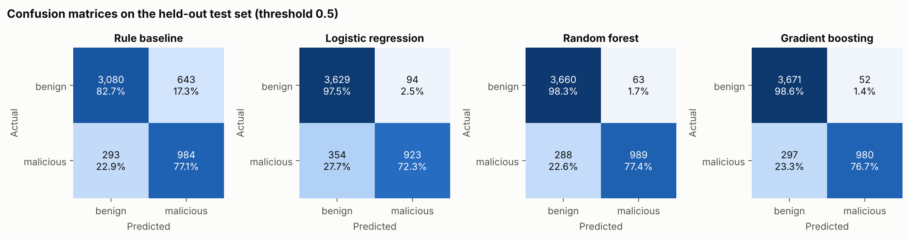
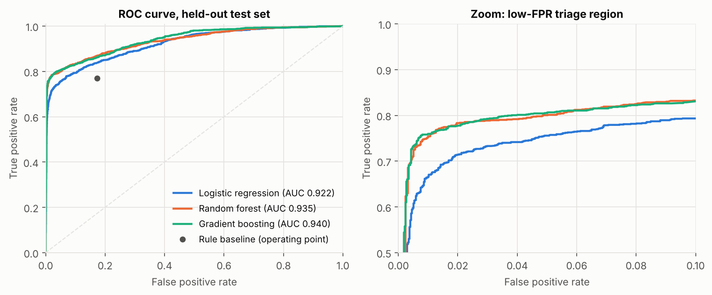
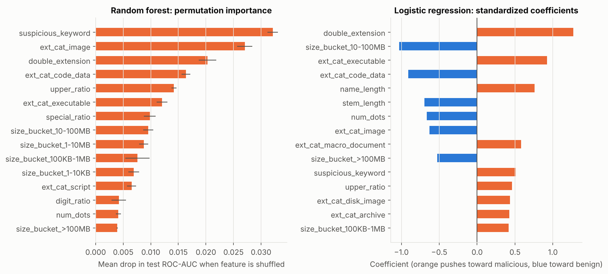
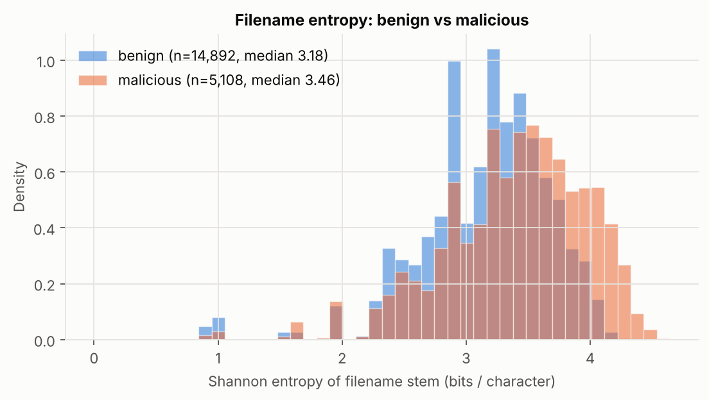
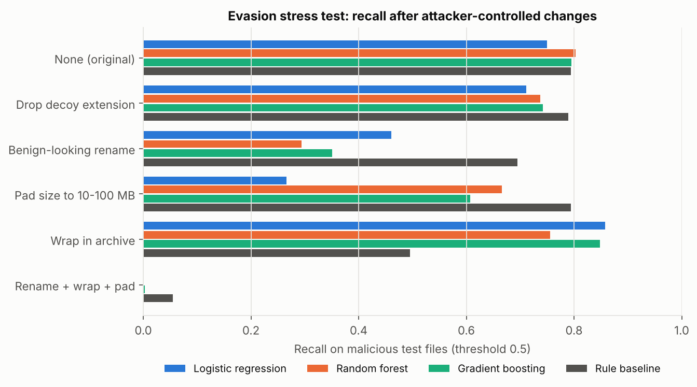

# Lightweight Machine-Learning Triage of Suspicious Files from Filename and Metadata Features

*file-triage-ml project. All numbers in this paper come from `python run_pipeline.py`
(seed 42) and the artefacts in `results/`.*

## Abstract

Security pipelines receive far more files than they can afford to detonate in a sandbox or send
to an analyst. We study how much signal sits in the cheapest metadata available before a file is
opened: its **name** and its **size**. We build a seeded synthetic corpus of 20,000 file records
from ten documented templates. These cover ordinary user files, deliberately hard benign files
(installers, admin scripts, hash-named caches) and common malicious delivery patterns (double
extensions, script droppers, random loader names, lure keywords, weaponised containers, size
anomalies), plus a "stealthy" malicious class that is indistinguishable by construction. From each
record we extract 29 features in about 26 µs: lexical statistics including Shannon entropy of the
name, an extension taxonomy, a double-extension flag, a lure-keyword flag and log-scale size
buckets. We compare a hand-written rule baseline with logistic regression, random forest and
histogram gradient boosting. On a held-out test set of 5,000 files, gradient boosting reaches
ROC-AUC 0.940 and the random forest reaches F1 0.849. At 1 % false-positive rate the learned models
recover 67–76 % of malicious files, against 10 % for the rule baseline. Results are stable across
five independent seeds (gradient boosting ROC-AUC 0.945 ± 0.003). An evasion stress test shows the
weakness of the approach: renaming a payload to a benign-looking name cuts random-forest recall
from 0.80 to 0.29, and combining renaming, archive wrapping and size padding cuts every model to
≈0. Metadata triage works as a fast prioritisation layer against non-adaptive commodity threats.
It is not a security boundary.

## 1 Introduction

Phishing attachments and drive-by downloads are still among the most common initial-access
vectors. MITRE ATT&CK lists *Spearphishing Attachment* (T1566.001) and several file-masquerading
techniques, such as *Double File Extension* (T1036.007) and *Right-to-Left Override* (T1036.002),
that act directly on how a file is named [1]. Defenders scan these files with signature engines,
static machine-learning models over file contents [2, 3] and dynamic sandboxes. These analyses
cost milliseconds to minutes per file, and a sandbox costs a VM slot, so in large environments
someone has to decide which files to analyse first.

This paper asks a narrow engineering question: **how far can a defender get using only a file's
name and size, with models cheap enough to run on every file?** Mail gateways, web proxies,
file-share crawlers and endpoint agents all see this metadata, and computing it requires no file
I/O beyond a directory listing. If it carries enough signal, it can order a sandbox queue, raise
alert priority or select files for a more expensive model.

Our contributions are:

1. A documented, seeded **synthetic dataset generator** for filename/size triage. It includes hard
   negatives, a deliberately undetectable malicious class and label noise, so that the task is not
   trivially separable (Section 3.1).
2. A **29-feature static metadata extractor** that runs in about 26 µs per file (Section 3.2).
3. A **comparison** of a rule baseline with three scikit-learn models, using cross-validation,
   held-out testing, low-FPR operating points and a five-seed stability study (Section 4).
4. An **evasion stress test** that measures how quickly an attacker who controls the metadata can
   defeat each model (Section 4.6), with a discussion of what this means for deployment
   (Section 5).

## 2 Background

### 2.1 Static file triage

Static malware detection classifies a file without running it. Mature systems work on file
contents: PE headers, imports, byte histograms and string features, as in the EMBER benchmark [2],
or learned representations of raw bytes [3]. Entropy of the content has long been used to spot
packed or encrypted payloads [4]. These methods need the bytes of the file and, in the case of
EMBER, a format-specific parser. *Triage* comes earlier. It is a cheap ranking step whose purpose
is to allocate those more expensive analyses, and a triage filter can tolerate false positives
(they cost analysis time) much more easily than a final verdict can.

### 2.2 Why metadata carries signal

Several delivery tricks are visible in a file's name and size:

* **Extension masquerading.** Windows hides known extensions by default, so `invoice.pdf.exe`
  shows up as `invoice.pdf`. Trailing whitespace before the real extension (`photo.jpg      .scr`)
  pushes the real extension out of view [1].
* **Executable and script types in unusual places.** `.scr`, `.vbs`, `.js`, `.hta`, `.wsf`, `.lnk`
  and macro-enabled Office files (`.docm`, `.xlsm`) are rare among ordinary user files but common
  among droppers. Container formats (`.iso`, `.img`) have been used to get around Mark-of-the-Web
  propagation (ATT&CK T1553.005) [1].
* **Social-engineering vocabulary.** Lures reuse a small vocabulary: invoice, payment, shipment,
  DHL, password reset, voicemail, crack, keygen.
* **Machine-generated names.** Loaders and automatically generated droppers often have
  random-looking names. Character entropy is the same signal used to detect algorithmically
  generated domains [5].
* **Size anomalies.** Script droppers are kilobytes in size. Some actors pad binaries to hundreds
  of megabytes to get past scanners with size limits, and a "PDF" of a few hundred bytes is
  implausible.

### 2.3 Limitations known a priori

Filename and size are entirely under the attacker's control. Machine learning in adversarial
security settings is fragile [6, 7, 17], and evaluations are easily skewed by spurious correlations,
unrealistic base rates and dataset artefacts [8, 9]. Low base rates make even small false-positive
rates expensive [10]. We therefore treat metadata triage as a prioritisation tool, evaluate it at
low-FPR operating points and measure evasion directly.

## 3 Methodology

### 3.1 Synthetic dataset

`src/data_generation.py` produces records of the form `(filename, size_bytes, template, label)`
from a single `numpy` generator (seed 42). Of the 20,000 records, 15,000 are drawn from benign
templates and 5,000 from malicious templates. Benign records come from four templates. *Common*
files (12,270) use word-based names, camera names (`IMG_1234`), screenshots, dated exports,
hash/UUID cache names (legitimately high entropy) and "Copy of" duplicates, with 27 common
extensions. *Installers* (1,152) are real-looking vendor installer names
(`python-3.12.4-amd64.exe`). *Risky-type* files (991) are legitimate `.ps1/.bat/.sh/.js/.dll/
.lnk/.iso` files. *Compound* files (587) carry legitimate multi-dot extensions (`tar.gz`,
`csv.bak`). Sizes are log-normal with medians typical for each type, for example ~2.8 MB for JPEG
and ~80 KB for DOCX. Malicious records come from six templates: double extension (1,190),
lure-named executable/script (1,022), random high-entropy name (920), weaponised
container/macro document (891), size anomaly (378) and **stealthy** (599, about 12 % of malicious
files). Stealthy files have an ordinary name, extension and size and therefore set a ceiling on
attainable recall. Benign keywords overlap with lure keywords ("invoice", "update", "tax") on
purpose. Finally, 1 % of labels are flipped uniformly at random (194 flips), giving a final
malicious rate of 25.5 % (5,108 files).

### 3.2 Features

`src/features.py` maps each `(filename, size)` pair to 29 numeric features:

* **Lexical (9):** name length, stem length, Shannon entropy of the stem
  H = −Σ p(c) log₂ p(c) in bits/char, digit ratio, upper-case ratio, special-character ratio,
  number of dots, whitespace-padding flag (three or more consecutive spaces) and suspicious-keyword
  flag (regex over 48 lure terms in the stem).
* **Extension (13):** a `double_extension` flag, set when the second-to-last extension is a decoy
  type (document, image, media, archive) *and* the last extension is executable, script or
  shortcut, so that `tar.gz` does not trigger it; and a one-hot encoding of 12 extension categories
  (document, macro document, image, media, archive, disk image, code/data, web, executable, script,
  shortcut, other).
* **Size (7):** one-hot log-scale size buckets with edges at 1 KB, 10 KB, 100 KB, 1 MB, 10 MB and
  100 MB.

### 3.3 Models

All models are in `src/models.py`:

* **Rule baseline:** a hand-written rule with no learning. It flags a file if it has a double
  extension, whitespace padding, a script/shortcut/macro-document type, or an executable type
  combined with a lure keyword. A three-level score (1 / 0.5 / 0) makes ROC-AUC defined.
* **Logistic regression (LR):** standardised features, L2 penalty with C = 1.
* **Random forest (RF):** 300 trees, `min_samples_leaf = 2` [11].
* **Gradient boosting (GB):** scikit-learn `HistGradientBoostingClassifier` with 300 iterations
  and learning rate 0.08 [12, 13].

We did no hyper-parameter search. The aim is to compare model *families* at sensible defaults
[14].

### 3.4 Protocol

We split the data with a stratified 75/25 split (15,000 train / 5,000 test, 1,277 malicious test
labels). On the training set we run 5-fold stratified cross-validation, then refit each model on
the full training set and evaluate once on the test set. We report accuracy, precision, recall and
F1 at threshold 0.5, ROC-AUC [15], average precision (PR-AUC) [16], TPR at 1 % FPR and precision
at 90 % recall. For interpretation we use random-forest permutation importance (decrease in test
ROC-AUC, 5 repeats) and LR standardised coefficients. For robustness, the whole pipeline
(generation, split, fit, test) is repeated with seeds 0–4. The evasion test is described in
Section 4.6. The whole run, including the five-seed study, takes 54 s of wall-clock time on the
build machine.

## 4 Experiments & Results

### 4.1 Overall performance

**Table 1.** Held-out test set (n = 5,000), threshold 0.5. Source: `results/metrics.csv`.

| Model | Accuracy | Precision | Recall | F1 | ROC-AUC | PR-AUC | TPR @ 1 % FPR | Prec. @ 90 % recall |
|---|---|---|---|---|---|---|---|---|
| Rule baseline | 0.8128 | 0.6048 | 0.7706 | 0.6777 | 0.8264 | 0.6217 | 0.0983 | 0.2554 |
| Logistic regression | 0.9104 | 0.9076 | 0.7228 | 0.8047 | 0.9220 | 0.8710 | 0.6656 | 0.4858 |
| Random forest | 0.9298 | 0.9401 | 0.7745 | **0.8493** | 0.9350 | 0.8988 | 0.7533 | 0.5391 |
| Gradient boosting | **0.9302** | **0.9496** | 0.7674 | 0.8489 | **0.9397** | **0.9020** | **0.7596** | **0.5492** |

All three learned models beat the rule baseline by a wide margin. The rule's recall is comparable
(0.771), but it pays for that with a 17.3 % false-positive rate (643 of 3,723 benign test files),
while the tree models stay at 1.4–1.7 %. The two tree ensembles are effectively tied: GB is
slightly ahead on ranking metrics (ROC-AUC 0.940 vs 0.935) and RF slightly ahead on F1 (0.8493 vs
0.8489). LR trails by about 0.015 AUC and 0.045 F1, which suggests that the useful signal includes
feature interactions, for example "archive *and* small", that a linear model cannot express.
Five-fold cross-validation on the training set agrees with the test results (ROC-AUC: LR
0.919 ± 0.004, RF 0.932 ± 0.004, GB 0.942 ± 0.004; `results/cv_metrics.csv`).

Recall at threshold 0.5 is around 0.77 for all models. This is expected, because the stealthy
class (about 12 % of malicious files) and label noise are undetectable from metadata by design.
For a triage use case, the low-FPR region matters more. At 1 % FPR, GB recovers 76.0 % of
malicious files and RF 75.3 %, against 9.8 % for the rule baseline. Precision at 90 % recall
falls to 0.54–0.55 for the trees: to catch nine out of ten malicious files, about one flagged file
in two would be benign.

### 4.2 Confusion matrices

**Figure 1.** Test-set confusion matrices (counts and row percentages). Source:
`results/confusion_matrices.csv`.

RF produces 63 false positives and 288 false negatives. GB produces 52 FP and 297 FN, and LR 94 FP
and 354 FN. The rule baseline makes most of its errors on the benign side (643 FP).

### 4.3 ROC analysis

**Figure 2.** ROC curves on the test set (left) and the low-FPR region, FPR ≤ 10 % (right). The
rule baseline is shown as its single operating point.

All learned curves rise steeply to TPR ≈ 0.75 at FPR < 1 % and then flatten. The steep part
corresponds to the "easy" malicious templates (double extension, lure executables, random names).
The flat part reflects the stealthy and container files, which overlap with benign data. In the
triage region the trees clearly dominate LR: at 2 % FPR they reach TPR ≈ 0.78 against ≈ 0.71 for
LR.

### 4.4 Which features matter

**Figure 3.** Left: random-forest permutation importance, measured as the drop in test ROC-AUC
when a feature is shuffled. Right: logistic-regression standardised coefficients. Source:
`results/feature_importance.csv`.

The strongest RF features are `suspicious_keyword` (ΔAUC 0.032), `ext_cat_image` (0.027, a strong
*benign* indicator), `double_extension` (0.020), `ext_cat_code_data` (0.016), `upper_ratio`
(0.014) and `ext_cat_executable` (0.012), followed by the size buckets. LR gives its largest
positive weight to `double_extension` (+1.27) and `ext_cat_executable` (+0.92), and its largest
negative weights to `size_bucket_10-100MB` (−1.03, typical of legitimate installers and media)
and `ext_cat_code_data` (−0.91). The two models therefore rely on the same handful of signals:
extension semantics, masquerading, lure vocabulary and size plausibility.

### 4.5 Filename entropy

**Figure 4.** Distribution of Shannon entropy of the filename stem, benign vs malicious (density).

Malicious stems have higher entropy on average (median 3.46 vs 3.18 bits/char), and the region
above ~4.0 bits/char is almost exclusively malicious (random loader names). The distributions
still overlap heavily, because hash- and UUID-named benign cache files are also high-entropy and
many malicious lures use ordinary words. Once the other lexical features are present, entropy adds
little: its RF permutation importance is only 0.003 ΔAUC, since `upper_ratio`, `digit_ratio` and
the length features capture much of the same "machine-generated name" signal. On its own entropy
is a weak cue, though it helps in combination.

### 4.6 Per-template behaviour and evasion

**Table 2.** Fraction of test files flagged (threshold 0.5) by generation template. Source:
`results/per_template_flag_rate.csv`.

| Template | n | Rule | LR | RF | GB |
|---|---|---|---|---|---|
| benign_common | 3102 | 0.050 | 0.006 | 0.008 | 0.007 |
| benign_installer | 277 | 0.874 | 0.029 | 0.004 | 0.007 |
| benign_risky_type | 239 | 0.908 | 0.213 | 0.092 | 0.071 |
| benign_compound | 135 | 0.178 | 0.037 | 0.015 | 0.000 |
| mal_double_ext | 287 | 1.000 | 1.000 | 1.000 | 1.000 |
| mal_lure_exec | 271 | 1.000 | 0.996 | 1.000 | 1.000 |
| mal_random_name | 234 | 0.944 | 0.885 | 0.974 | 0.979 |
| mal_container | 234 | 0.705 | 0.684 | 0.756 | 0.769 |
| mal_size_anomaly | 83 | 0.506 | 0.133 | 0.434 | 0.301 |
| mal_stealthy | 138 | 0.029 | 0.000 | 0.014 | 0.000 |

(Benign rows include the ~1 % of records whose label was flipped. Flag rates in malicious rows are
recall against the generating template.)

The learned models' main advantage over the rule is on **hard negatives**. The rule flags 87 % of
legitimate installers and 91 % of legitimate scripts. RF flags 0.4 % and 9.2 % respectively,
because it learns that a large `.exe` with a version-number name is typical of an installer. The
size-anomaly class is detected less reliably (RF 43 %, LR 13 %), since tiny "documents" look like
ordinary files apart from their size. Stealthy files are essentially never caught, as designed.

**Evasion stress test.** `src/evasion.py` takes the 1,247 test files whose clean label is
malicious, applies attacker-controlled transformations, re-extracts the features and re-scores the
files with the trained models.

**Table 3.** Recall after transformation (threshold 0.5). Source: `results/evasion_recall.csv`.

| Attack | Rule | LR | RF | GB |
|---|---|---|---|---|
| None (original) | 0.794 | 0.750 | 0.803 | 0.796 |
| Drop decoy extension (`a.pdf.exe` → `a.exe`) | 0.789 | 0.711 | 0.738 | 0.743 |
| Benign-looking rename (keep extension) | 0.694 | 0.460 | 0.294 | 0.350 |
| Pad size to 10–100 MB | 0.794 | 0.266 | 0.666 | 0.607 |
| Wrap in archive (`.zip/.7z/.rar`) | 0.496 | 0.858 | 0.755 | 0.848 |
| Rename + wrap + pad | 0.055 | 0.000 | 0.000 | 0.002 |

**Figure 5.** Recall on malicious test files under each attacker transformation.

Three effects stand out. (i) The learned models depend on the *name* more than the rule does: a
benign-looking rename cuts RF recall by 51 points, against 10 points for the rule, which looks
mainly at the extension. (ii) LR is particularly sensitive to size padding (0.750 → 0.266),
because it has learned a large negative weight on the 10–100 MB bucket. (iii) Wrapping a payload
in an archive *raises* LR and GB recall. In our data, malicious archives are small (median
~400 KB) while benign archives are large (median ~20 MB), so a small archive is itself suspicious.
This is plausible (lure archives are usually small) but it is also exactly the kind of correlation
an attacker can break, and padding the archive does so. When the three cheap tricks are combined,
every model falls to ≤ 5.5 % recall.

### 4.7 Stability and cost

Over five independently generated datasets (seeds 0–4; `results/seed_stability.csv`) we obtain the
following. GB: F1 0.845 ± 0.005, ROC-AUC 0.945 ± 0.003. RF: F1 0.842 ± 0.007, ROC-AUC
0.937 ± 0.004. LR: F1 0.793 ± 0.007, ROC-AUC 0.919 ± 0.004. Rule: F1 0.665 ± 0.010, ROC-AUC
0.819 ± 0.007. The ROC-AUC ranking (GB > RF > LR > rule) holds for every seed. On F1, RF and GB trade places (RF is ahead on seed 2), so the two ensembles should be considered tied on F1.

Feature extraction costs about 26 µs per file in pure Python. Batch inference costs 0.5 µs per file
for LR, 2.4 µs for GB and 25 µs for RF (dominated by thread-pool overhead on a batch of 5,000)
(`results/metrics.csv`, `results/timing.json`). All of these are orders of magnitude cheaper than
content scanning or sandboxing.

## 5 Discussion & Limitations

**Where metadata triage helps.** Against commodity delivery that reuses well-known tricks, a few
microseconds of computation on name and size recover about three quarters of malicious files at
1 % FPR. In a pipeline with a limited sandbox budget, ranking files by GB score would send these
files to the front of the queue. The learned models' low flag rate on installers and admin scripts
matters in practice: the obvious hand-written alternative (Table 2, Rule) would bury analysts in
alerts about legitimate software.

**Base rates.** Our test prevalence is 25.5 %, far higher than in most real traffic. Precision
depends on prevalence. Plugging the measured operating point of GB (TPR 0.767, FPR 0.014) into a
1 % prevalence gives a precision of about 0.36 (0.01·0.767 / (0.01·0.767 + 0.99·0.014)), so roughly
two of every three flags would be benign [10]. That is acceptable for *prioritisation* but rules
out using the score as a blocking verdict.

**Evasion.** The threat model is the central limitation. Name and size are fully attacker
controlled. Section 4.6 shows that three trivial transformations defeat every model, and that the
more a model exploits lexical cues, the more a rename hurts it. This is not specific to our models:
any detector built only on attacker-controlled features is evadable at near-zero cost [6, 7].
Metadata triage should therefore (a) never lower the scrutiny a file would otherwise get,
(b) only re-order or add analysis, and (c) be combined with features attackers control less well,
such as content, provenance and Mark-of-the-Web, sender reputation and behaviour. Some
countermeasures are cheap. Unpacking archives and scoring their *contents'* names removes the
archive-wrap trick. Treating padding toward round sizes as its own anomaly feature makes padding
more expensive. Adversarial training on transformed samples could reduce, though not remove, the
sensitivity to renaming.

**Synthetic data.** All data is synthetic. The templates encode documented attacker behaviour and
typical file statistics, but the mixture weights, vocabularies and size distributions are our
choices, and models partly learn the generator. The "small archive" artefact (Section 4.6) shows
how a generator assumption becomes a decision rule. Absolute numbers should therefore not be read
as production performance. The relative findings carry over more safely: tree ensembles beat linear
models and hand rules on hard negatives, extension semantics and lure vocabulary dominate, and
evasion is cheap. We avoid several common pitfalls [8]. The split is stratified and fixed before
any modelling, hyper-parameters were not tuned on the test set, a stealthy class and label noise
prevent an unrealistically separable task, and results are reported over five seeds. Temporal
drift [9] cannot be studied with stationary synthetic data and remains open.

**Other limitations.** Features are Windows-centric (extension hiding, `.scr`, `.lnk`). The keyword
list is English-only and fixed, and it overlaps with the generator vocabulary, which inflates its
measured importance. Unicode tricks such as right-to-left override and homoglyphs are not modelled.
We use a single threshold of 0.5 and do not calibrate probabilities.

## 6 Conclusion

Using only a file's name and size, lightweight scikit-learn models separate benign from malicious
files with ROC-AUC 0.935–0.940 (tree ensembles) on a realistic synthetic benchmark. At 1 % false
positives they recover about 75 % of malicious files, against about 10 % for an equivalent
hand-written rule, and they are far better at not flagging legitimate installers and scripts.
Features cost about 26 µs per file, and inference costs a few microseconds. The same models are
trivially evadable: a benign rename, an archive wrapper and size padding together drive recall to
≈0. We therefore recommend metadata ML only as a **prioritisation layer** that decides what gets
analysed first and never what gets analysed less. Future work should validate the approach on real
labelled gateway logs, add features from inside archives and from provenance, and evaluate under
temporal drift and adaptive adversaries.

## References

[1] MITRE ATT&CK. Techniques T1566.001 (Phishing: Spearphishing Attachment), T1036.007
(Masquerading: Double File Extension), T1036.002 (Masquerading: Right-to-Left Override),
T1553.005 (Subvert Trust Controls: Mark-of-the-Web Bypass). https://attack.mitre.org/

[2] H. S. Anderson and P. Roth. "EMBER: An Open Dataset for Training Static PE Malware Detection
Models." arXiv:1804.04637, 2018.

[3] J. Saxe and K. Berlin. "Deep Neural Network Based Malware Detection Using Two Dimensional
Binary Program Features." In *Proc. 10th Int. Conf. on Malicious and Unwanted Software (MALWARE)*,
2015.

[4] R. Lyda and J. Hamrock. "Using Entropy Analysis to Find Encrypted and Packed Malware."
*IEEE Security & Privacy*, 5(2):40–45, 2007.

[5] M. Antonakakis, R. Perdisci, Y. Nadji, N. Vasiloglou, S. Abu-Nimeh, W. Lee, and D. Dagon.
"From Throw-Away Traffic to Bots: Detecting the Rise of DGA-Based Malware." In *Proc. 21st USENIX
Security Symposium*, 2012.

[6] B. Biggio and F. Roli. "Wild Patterns: Ten Years After the Rise of Adversarial Machine
Learning." *Pattern Recognition*, 84:317–331, 2018.

[7] B. Kolosnjaji, A. Demontis, B. Biggio, D. Maiorca, G. Giacinto, C. Eckert, and F. Roli.
"Adversarial Malware Binaries: Evading Deep Learning for Malware Detection in Executables." In
*Proc. 26th European Signal Processing Conference (EUSIPCO)*, 2018.

[8] D. Arp, E. Quiring, F. Pendlebury, A. Warnecke, F. Pierazzi, C. Wressnegger, L. Cavallaro, and
K. Rieck. "Dos and Don'ts of Machine Learning in Computer Security." In *Proc. 31st USENIX Security
Symposium*, 2022.

[9] F. Pendlebury, F. Pierazzi, R. Jordaney, J. Kinder, and L. Cavallaro. "TESSERACT: Eliminating
Experimental Bias in Malware Classification across Space and Time." In *Proc. 28th USENIX Security
Symposium*, 2019.

[10] S. Axelsson. "The Base-Rate Fallacy and the Difficulty of Intrusion Detection." *ACM
Transactions on Information and System Security*, 3(3):186–205, 2000.

[11] L. Breiman. "Random Forests." *Machine Learning*, 45(1):5–32, 2001.

[12] J. H. Friedman. "Greedy Function Approximation: A Gradient Boosting Machine." *Annals of
Statistics*, 29(5):1189–1232, 2001.

[13] G. Ke, Q. Meng, T. Finley, T. Wang, W. Chen, W. Ma, Q. Ye, and T.-Y. Liu. "LightGBM: A Highly
Efficient Gradient Boosting Decision Tree." In *Advances in Neural Information Processing Systems
30*, 2017.

[14] F. Pedregosa et al. "Scikit-learn: Machine Learning in Python." *Journal of Machine Learning
Research*, 12:2825–2830, 2011.

[15] T. Fawcett. "An Introduction to ROC Analysis." *Pattern Recognition Letters*, 27(8):861–874,
2006.

[16] T. Saito and M. Rehmsmeier. "The Precision-Recall Plot Is More Informative than the ROC Plot
When Evaluating Binary Classifiers on Imbalanced Datasets." *PLoS ONE*, 10(3):e0118432, 2015.

[17] R. Sommer and V. Paxson. "Outside the Closed World: On Using Machine Learning for Network
Intrusion Detection." In *Proc. IEEE Symposium on Security and Privacy*, 2010.
